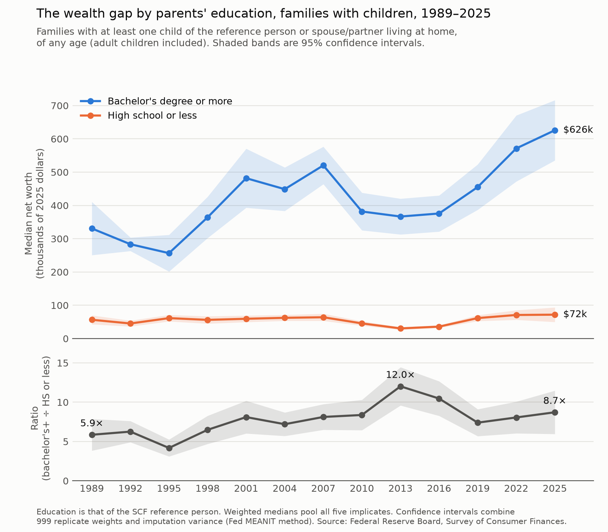

# Wealth gap by parents' education, 1989–2025



## The figure

[`figures/networth_gap_kids.png`](figures/networth_gap_kids.png) shows median net worth of US families with children, from 1989 to 2025, in 2025 dollars. It compares two groups:

- **Bachelor's degree or more**
- **High school or less**: no diploma, or a high school diploma or GED

Education is that of the survey's reference person (usually the head of household). Families where that person has some college or an associate degree are in neither group.

"Families with children" uses the Fed's `KIDS` variable: at least one child of the reference person or their spouse/partner lives at home. Children of any age count, including adults.

The bottom panel shows the ratio of the two medians. In 2025 it was 8.7× (95% CI 6.0–11.5×), up from 5.9× in 1989.

Shaded bands are 95% confidence intervals. They follow the Fed's MEANIT method from the SCF codebook: 999 replicate weights on the first implicate, plus 6/5 times the variance across the five implicates.

## Data

The data come from the Federal Reserve Board's [Survey of Consumer Finances](https://www.federalreserve.gov/econres/scfindex.htm) (SCF), one survey every three years from 1989 to 2025. `get_data.py` downloads two files per survey:

- **Summary extract** (`scfpYYYYexcel.zip`): one row per family per implicate, with weights, education, children and net worth.
- **Replicate weights** (`scfYYYYrw1s.zip`, or `scfYYrw1s.zip` before 2001): used for the confidence intervals.

The Fed reissues every year's extract in the dollars of its newest survey, so all files are currently in 2025 dollars. On every run, `get_data.py` checks its all-families medians against the Fed's published Table 4 and stops if any year differs. After the 2028 survey is released, those reference values in `get_data.py` will need updating.

## Rerunning

Requires Python 3. Set up the environment once:

```bash
python3 -m venv .venv && .venv/bin/pip install -r requirements.txt
```

Then download the data and draw the figure:

```bash
.venv/bin/python get_data.py && .venv/bin/python plot.py
```

The first run downloads about 330 MB into `data/raw/`; later runs reuse those files. The summary series is written to `data/median_networth_kids_by_educ.csv`. The `data/` folder is not tracked in git.
